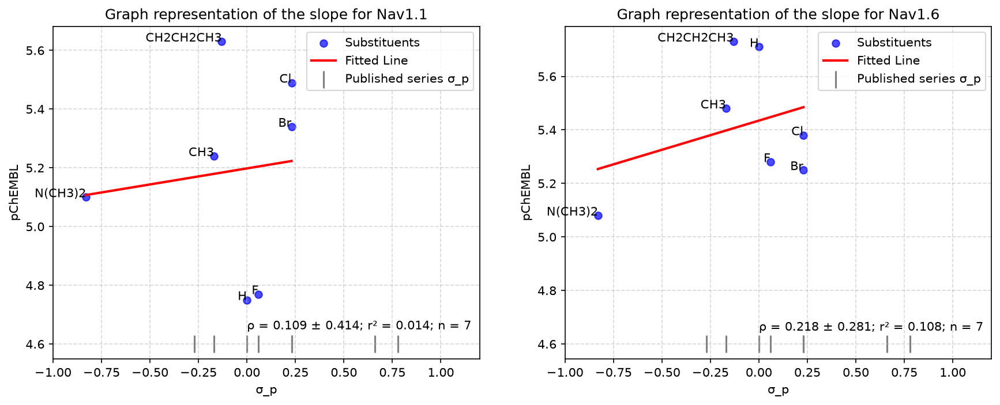

# Spirohydantoin QSAR

QSAR models for two voltage-gated channels and two serotonin receptors, applied to a series
of spirohydantoins synthesized and characterized in [Hemijska Industrija, 2019](https://doi.org/10.2298/HEMIND181203007L).

**Status:** Finished


## 1. Summary

This project tests the final sentence in the conclusion of the original paper. The paper speculated if the spirohydantoins substituents in the position 3 of the hydantoin ring with electron-donating groups could be potential active compounds for antimigraine drugs and if the spirohydantoins with electron-accepting groups could be potential active compounds for anticonvulsant drugs. Two datasets with four endpoints were built from ChEMBL. 
The original paper benchmarked the compounds against phenytoin, which acts at voltage-gated sodium channels Nav1.6 and Nav1.1. These channels were picked for anticonvulsant arm. For antimigraine arm 5-HT1D and 5-HT1B serotonin receptors were picked on which triptans act.
Several models were fitted per endpoint, one was selected by cross-validation and evaluated once on the holdout data. Nav1.1 was modelled as classification and the rest were modelled as regression. For both regression and classification models, there were fixed thresholds with declared consequence that if models don't meet them, they will be reported as negative and will not be used for prioritisation. Out of four models chosen for the holdout data, only the classification model passed all the preset criteria. Nav1.6 regression cleared both RMSE thresholds (RMSE < 0.7 and RMSE < 0.8 * SD) under random cross-validation folds and failed under scaffold-grouped folds. The classification model predicted all compounds to be Nav1.1-active. An applicability domain analysis placed target compounds outside of the domain for all four built models, on two out of three tests. No reliable predictions could therefore be made for target compounds.


## 2. Compounds

Thirteen target compounds come from the paper published in 2019, from the same author of this repo. They were synthesised and characterised at the University of Belgrade, Faculty of Technology and Metallurgy.
The compounds are two series of 3-substituted-7,8-benzo-1,3-diazaspiro[4.5]decane-2,4-diones, both substituted at position 3 of the hydantoin ring. The first is the benzyl series, 1a-1g, with X = H, CH₃, OCH₃, Cl, Br, CN, NO₂. The second is a phenacyl series, 2a-2f, with X = OCH₃, F, Cl, Br, CN, NO₂.
Compounds were generated through a script from the published substituent table, verified by molecular weight against the paper and by visual inspection of the rendered structures.


*Seven benzyl (1a–1g) and six phenacyl (2a–2f) derivatives sharing the 7,8-benzo-1,3-diazaspiro[4.5]decane-2,4-dione core.*


## 3. Data

Two datasets were built from ChEMBL with pairing endpoints. Pair of Nav1.1 and Nav1.6 making up Nav dataset, pair of 5-HT1B and 5-HT1D making up Serotonin dataset. Each dataset is an inner merge, so a compound appears only if ChEMBL holds a measurement for it at both subtypes of that pair. For Nav endpoints, influx was chosen over patch clamp, based on the greater number of measurements available for influx assay family. Because influx and clamp are two different types of measurement, mixing them was rejected. ChEMBL's assay_type field proved unreliable here, with most Nav1.6 records labelled as binding despite describing functional influx or patch clamp measurements. As a consequence, assay family was determined from the assay description rather than the type field. For Nav dataset the target variable is pIC50 and for serotonin dataset is pKi.

| Endpoint | n | SD | Range | Note |
|---|---|---|---|---|
| Nav1.1 | 711 | 0.44 | 4.52–6.85 | 116 compounds at exactly 4.52 |
| Nav1.6 | 711 | 0.73 | 4.52–9.00 | 3 at floor |
| 5-HT1B | 701 | 1.29 | 4.38–10.70 | |
| 5-HT1D | 701 | 1.21 | 4.99–10.00 | |

Inside the Nav dataset for Nav1.1 endpoint 116 compounds sit at 4.52 pIC50, which is 30 µM, a standard top screening concentration. Those values are censored rather than measured: the compound showed no effect up to the highest concentration tested, so the true value of pIC50 is below 4.52 and it is unknown. Of those 116 compounds only 3 compounds showed up at value of 4.52 for Nav1.6 endpoint. The other 113 are active at Nav1.6 and showed nothing at Nav1.1, which makes them Nav1.1-selective rather than inactive. Treating 4.52 as a measured value would have meant regressing on a number that does not exist, so Nav1.1 was modelled as classification instead, separating Nav1.1-active compounds from Nav1.1 selective ones. The remaining three endpoints were modelled as regression.
For Nav endpoints calculated correlation is 0.05 for Nav1.1 and Nav1.6 endpoints over 711 compounds. This means that for values of pIC50 there is no linear association between the endpoints. For 5-HT1 endpoints calculated correlation is 0.75 for 5-HT1D and 5-HT1B endpoints over 701 compounds. This implies that there is a linear association in pKi values between the receptors. The conclusion is that Nav endpoints carry different information and each needs its own model. The serotonin endpoints mostly carry the same information, so the separate models bring less value.
For both datasets there are no null values or duplicate compounds.


## 4. Method

For the training data, descriptors were chosen. 217 descriptors per compound, zero failures during molecule objects parsing, no NaN or infinite detected inside descriptors values. Descriptors with zero or near zero variance were dropped first, since unchanging descriptor value across the table carries no information. Because there are descriptors that give similar data (like molecule weight and number of heavy atoms), correlation calculation was done on descriptors. For every pair of descriptors that scored 0.95 and above, for correlation coefficient, one of them was dropped. That left Nav set with 130 features and serotonin set with 157 features. Filters were fitted on training data only. The target data was cut to the same matching columns. Salts were stripped from SMILES, serotonin compounds had 52 counterions.

Why were the descriptors chosen over fingerprints? Fingerprints carry no weight from absent structures in training data, so the model is blind to that feature and the failure is silent. With target compounds having spirohydantoin core, not expected inside the ChEMBL data, descriptors were chosen for the features. Descriptors are better suited for this situation, unseen chemotype in target compounds, because they remain defined on the same scale. At the end of the 04 notebook there is a comparison analysis between descriptors and fingerprints trained models, without a gate verdict because the holdout was spent.

Splits were made on Murcko scaffolds so that no scaffold appears in both training and test data. A model evaluated on the scaffolds it has already seen reports performance it will not reproduce on new chemistry. GroupShuffleSplit was used for the holdout data, then 5-fold GroupKFold cross-validation on the remainder. For hte Nav1.1 endpoint, plain GroupKFold distributed negative class unevenly, 5/8/18/19/14, so stratified grouping was used which produced 13/13/12/13/13. Final sizes for Nav were 577 train/134 holdout, with 52 negatives in the holdout and 64 in the training data. For the serotonin set it was 550 train/151 holdout.

All the random states are fixed at 42 for the project, but for Nav set the distribution of scaffolds was imbalanced for the training and holdout data. 10,000 seeds were scanned against three criteria fixed in advance: a holdout fraction between 0.18 and 0.24, no single scaffold accounting for more than 25% of the holdout and at least 20 negatives in the holdout. 138 seeds passed and from them seed 1764 was chosen having the lowest scaffold concentration and highest negative count. During the selection no models were fitted with the data.

The thresholds were fixed before any fitting with declared consequences. If an endpoint fails its gate it is reported as negative and it is not used for prioritisation. Regression required both absolute and relative gate for root mean squared error to be cleared, to beat the null model and to score R² below or equal to 0.05 on y-scrambled data. For the classifier there were four criteria to beat: AUC, BA, NPV and TNR, with NPV and TNR on minority class. Accuracy was excluded on purpose, because dummy classifier scored 88.9% plain accuracy while getting every minority-class (negative) compound wrong.

For y-scrambling twenty iterations were done per endpoint, with labels permuted and pipeline refitted each time.

## 4.1 Hammett analysis

Inside the original paper (DOI 10.2298/HEMIND181203007L), there was a closing statement that suggested that electron-withdrawing para substituents predict anticonvulsant potential and that electron-donating para substituents predict antimigraine potential. Analysis on ChEMBL data with Hammett regression was a way to test this hypothesis.

Both datasets were screened for a congeneric series varying at a single aromatic position with σ spanning donors and acceptors, against a gate fixed in advance:
* at least 6 compounds as floor 
* varying at the single aromatic position
* having σ interval of 0.8 between both donors and acceptors.

Serotonin:
Most of the scaffolds were fused heteroaromatics and last analysed scaffold was multiple benzene rings with multiple scaffolds attachments. For this type of compounds positioning count couldn't be done.

Nav:
From five biggest scaffolds, one satisfied the criteria.
It has 7 distinct substituents: H, F, Cl, Br, CH₃, CH₂CH₂CH₃, NMe₂, in the position R5, with σ_p ranging from -0.83 to 0.23.

| Target | ρ | stderr | r² | p |
|---|---|---|---|---|
| Nav1.1 | 0.109 | 0.414 | 0.014 | 0.80 |
| Nav1.6 | 0.218 | 0.281 | 0.108 | 0.47 |


*Seven compounds varying at the para position of the aromatic ring*

The slopes of the both endpoints are indistinguishable from zero.

With the leave-one-out approach it was seen that there is no drastic impact on the value of the slope for any of the compounds, outside the NMe₂. The biggest shift is seen in removing the NMe₂ substituent whose removal changes the sign of the slope from positive to negative. In the literature the value of σ_p ranges from -0.21 all the way to -1.05 for NMe₂, making the impact of this substituent dependent on the source of the transcribed value.

The preregistered gate for candidates was σ_p range of at least 0.8. Without NMe₂ substituent the range collapses to -0.17 to 0.23, at which the series would not pass. The single substituent is the sole reason this series passed.

No observed correlation between the value of the pIC50 with the substituent.

The claim inside the original paper was not a measured result, but rather a hypothesis on the chemical relationship between the substituent and the scaffold. The analysis inside this project does not disprove that claim, but rather it fails to confirm it.

It is worth noting that this is not the classical Hammett plot. There is no ionising reaction centre and the reference point is not defined by the reacting point on the para position, but rather the methylene linker. This is closer to the Hansch style single-term electronic regression.


## 5. Results 

Four models were picked for holdout evaluation, three Random Forest Regressor models for Nav1.6, 5-HT1D and 5-HT1B endpoints and one Random Forest Classification model for Nav1.1 endpoint. The thresholds were preregistered before the evaluation of the models even started. All endpoints that fail any of them would be reported as negative.

| Endpoint | Null | Model | Gate | Verdict |
|---|---|---|---|---|
| Nav1.6 | RMSE 0.867, R² -0.012 | RMSE 0.719, R² 0.303 | RMSE < 0.587 and RMSE < 0.7 | Failed | 
| 5-HT1B | RMSE 1.168, R² -0.029 | RMSE 0.851, R² 0.454 | RMSE < 1.03 and RMSE < 0.7 | Failed | 
| 5-HT1D | RMSE 1.115, R² -0.018 | RMSE 0.915, R² 0.314 | RMSE < 0.97 and RMSE < 0.7 | Failed | 
| Nav1.1 | AUC 0.50, BA 0.50, TNR 0.00, NPV 0.00 | AUC 0.832, BA 0.755, TNR 0.692, NPV 0.706 | AUC > 0.70, BA > 0.65, TNR > 0.50, NPV > 0.40 | Passed |

All three regression models beat their nulls, but failed absolute RMSE threshold. The classifier is the only model that passed all preset thresholds against holdout data. Cross-validation analysis, with threshold sweep over pooled out-of-fold probabilities, on classification model suggested that both TNR and NPV couldn't have been met at the same time. This was due to the fact that there were only 12 or 13 negatives in each cross-validation fold against the 52 negatives in the holdout data. This means that cross-validation analysis failed to detect the model that would meet all the criteria set for the models; the scheme was too imprecise to detect it.

| Endpoint | Scaffold CV | Random CV | Gap |
|---|---|---|---|
| Nav1.6 | 0.617 | 0.565 | 0.052 | 
| 5-HT1B | 0.837 | 0.749 | 0.088 |
| 5-HT1D | 0.791 | 0.738 | 0.053 |

All three regression models performed better under random cross-validation folds than under scaffold-grouped validation. Nav1.6 clears its gate under random folds and fails under scaffold-grouped folds. A random split would have reported a passing model that does not generalise to unseen scaffolds, which is the failure mode scaffold splitting exists to expose.

All three Random Forest Regression models passed the initial target of R² ≤ 0.05 for y-scramble test. Nav1.6 averaged -0.088 (for real model CV R² was 0.162), 5-HT1B averaged -0.107 (for real model CV R² was 0.585) and 5-HT1D averaged -0.094 (for real model CV R² was 0.582) which established that performance is not an artifact of the validation procedure. The Random Forest classification also passed its own target of AUC ≤ 0.55 with value of 0.510. It is worth noting that three out of twenty individual iterations exceeded 0.55, which can be attributed to the same 12 to 13 negatives per fold.

The hypothesis from the original paper was not confirmed. The Hammett regression analysis found no relationship between substituents in the only passing scaffold and Nav binding affinity. The QSAR models could not address the claim either. The three regression models failed the pre-registered gates. For the only classifier model that passed all four of its gates, target compounds fell outside the applicability domain. This means that the predictions on them could not be trusted.


## 6. Applicability domain

Applicability domain thresholds were fixed before the domain quantities were computed, but after the main analysis rather than at pre-registration. On two out of three thresholded measures, the thirteen compounds fall outside the domain of the Nav1.1 classifier.

| Measure | Threshold | Result on the thirteen | Verdict |
|---|---|---|---|
| Tanimoto similarity (ECFP4, r=2, 2048 bits) | max similarity to any training compound > 0.35 | 0.133 – 0.226 | Outside |
| Descriptor-space distance | mean 5-NN distance < 95th percentile of training 5-NN distances (14.58) | 62.6 – 83.7 | Outside |
| Rank stability | mean pairwise Spearman across 20 bootstrap refits > 0.5 | 0.809 | Passed |

Tanimoto similarity coefficient showed that target compounds have maximum similratity of 0.226 to any compound inside Nav1.1 dataset. This is well under the 0.35 threshold. On the other hand, distance of descriptors was also drastic compared to the cutoff (closest distance was 62.6 to cutoff of 14.58). The distance was also verified with comparison of molecular weight between the compounds (range of 306-413) against the interval of training compounds (481 ± 35). This placed the compounds on both measurements well outside the domain.

Rank stability over twenty bootstrap refits passed the predefined threshold with value of 0.809 against the 0.500. The two series sit at systematically different descriptor-space distance, 62.6 - 64.7 for the benzyl set and 82.4 - 83.7 for the phenacyl set. The ordering is reproducible and consistent, but it reflects where they sit relative to the training data rather than any tracking of Nav1.1 selectivity. 

Tree variance spans on the interval between 0.407 - 0.497 and it overlapped with the holdout interval which was 0.077 - 0.500. On the target compounds, the forest's votes split close to 50/50 on every compound and the spread across compounds is narrow (standard deviation of 0.026) where on the holdout it varies widely (standard deviation of 0.109). The predicted probabilities show the same pattern, a range of 0.210 - 0.448 against the holdout's 0.006 - 0.988, compressed about the fourfold, with means that are similar (0.351 against 0.396). The model is not leaning toward either class on these compounds. It is undecided, uniformly, on all of them. Because the two ranges overlap, this is supporting evidence rather than an independent test of domain membership.

No prioritisation of the series is supported by these predictions. This statement shows where the compounds sit relative to the training data and it is not the comment on the classifier. The classifier's holdout performance on the Nav-like chemistry stands as reported.


## 7. Limitations 

* Applicability domain thresholds were set after the main analysis was done, rather than at pre-registration. 

* The fingerprints analysis was run after the holdout was spent, so those models gave no gate verdict. The analysis was run as a comparison of what performance could model achieve with fingerprints training data. Further evaluation would require a fresh holdout split.

* No external validation beyond the single holdout split.

* There was only one nonlinear model family used, without boosting.

* The Nav sets are the intersection of compounds tested at both Nav1.6 and Nav1.1, so they are not all the Nav data found in ChEMBL. Compounds measured at both subtypes tend to come from selectivity studies, so the sample is not representative of either Nav chemistry generally.

* 52 of 116 negatives inside Nav1.1 went to the holdout, leaving only 64 for training and cross-validation. This made it good for gate evaluation, but weak for cross-validation.


## 8. Reproducing

```bash
conda env create -f environment.yml
conda activate chem
```
Run the notebooks in the order they appear in the table.

| Notebook | What it does | Runtime |
|---|---|---|
| `00_compound_writer` | Builds the thirteen target compounds from the published substituent table | < 1 min |
| `01_data_extraction` | Retrieves and filters ChEMBL data, builds both datasets | ~3 min cached, 30+ min first run |
| `02_scaffold_analysis` | Murcko binning, R-group decomposition, Hammett feasibility screen | ~1 min |
| `03_hammett_analysis` | Electronic regression on the one qualifying series | < 1 min |
| `04_model_building` | Descriptors, splits, models, holdout, applicability domain | ~17 min |

`01_data_extraction` retrieves from the ChEMBL API. The first run is slow and may need rerunning if the connection drops; `chembl_webresource_client` caches responses locally, so later runs are much faster. Notebooks 02 to 04 read the committed datasets in `data/processed/` and do not need 01 to have been run.

### Files

* `data/raw/` — the ChEMBL extracts are not committed. Notebook 01 regenerates them from the API. The exception is `constant_values.csv`, the σ constants transcribed by hand from Hansch, Leo and Taft, which is committed because nothing in the repo reproduces it.
* `data/processed/` — the cleaned Nav (711) and serotonin (701) datasets, the thirteen target compounds, and the Hammett candidates
* `figures/` — the structure renders for the thirteen target compounds, the Hammett plot, and the scaffold core renders from the feasibility screen in notebook 02, used to assign ring positions
* `notebooks/` — the five notebooks, run in order

All the random states are fixed at value 42 except for the Nav holdout split, which uses seed 1764. That seed was selected by a documented scan described in section 4 and implemented in `04_model_building.ipynb`.


